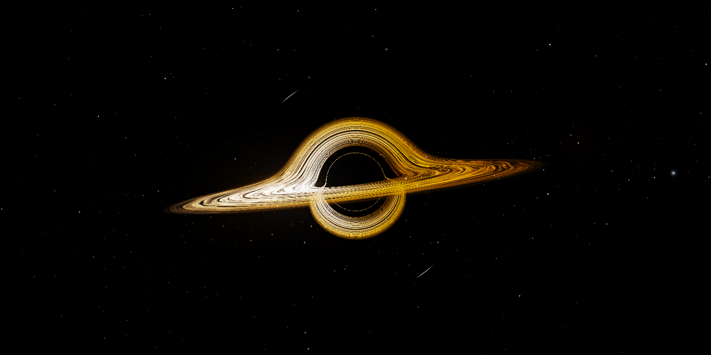
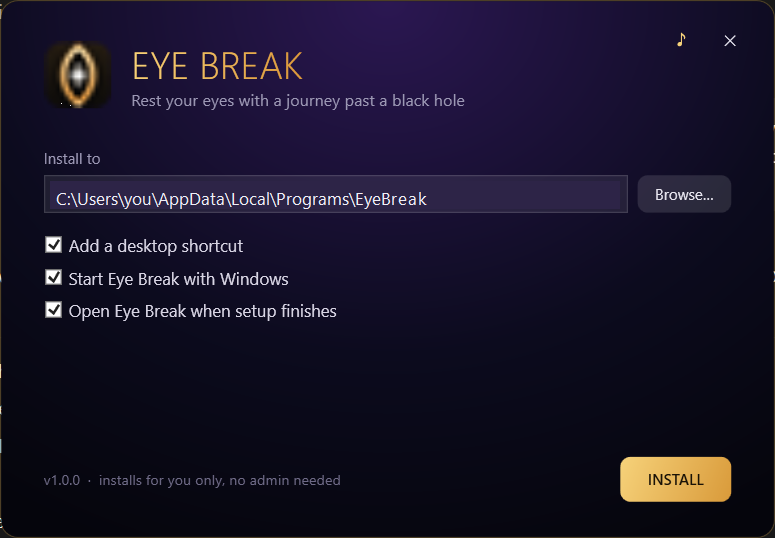

<div align="center">

# Eye Break

**A 20-20-20 eye-rest app for Windows, with a journey past a black hole.**

[](https://github.com/dev2180/eye-break/actions/workflows/build.yml)
[](https://github.com/dev2180/eye-break/releases/latest)
[](https://github.com/dev2180/eye-break/releases)
[](LICENSE)




</div>

Every 20 minutes your eyes close over the whole screen, like settling into meditation. You fall into a ray-traced black
hole for 20 seconds, a white star is born in the darkness, and a third eye opens you back to your screen. Your apps keep
running underneath.

## Download

**[Download EyeBreak-Setup.exe](https://github.com/dev2180/eye-break/releases/latest)**: one file, no admin rights
or .NET needed. It works on Windows 10 and 11.

Windows may say "Windows protected your PC", because the file isn't code-signed yet. Click **More info → Run anyway**.



Once installed, Eye Break updates itself: when a new version is out, the panel shows an **Update** button.
To uninstall, go to **Settings › Apps › Installed apps**.

## Features

- **The break:** eyelids close, then a real-time ray-traced black hole (gravitational lensing, Doppler beaming, a
  turbulent accretion disk) with a ring timer, then the white star and the third eye.
- **Infinite mode:** float by the black hole with music (presets, your own YouTube link, or search) and calm quotes.
  Set a session timer, which chimes at the start and end, or press **Esc** to return.
- **Tray panel:** time to your next break, take a break now, skip breaks (30 min, 1 h, 2 h or until you resume),
  and settings (interval, break length, start with Windows, hide from screen sharing, updates).
- **Stays out of your way:** it covers every monitor and blocks the Windows key and Alt+Tab during a break, while
  typing still reaches your app. Locking your PC restarts the cycle.
- **Games:** in exclusive-fullscreen games it dims the display output instead, and always restores it.
- **Screen sharing:** breaks are hidden from screen shares and recordings (on by default).

### Shortcuts

| Keys | During | What it does |
|---|---|---|
| **Esc** | Infinite mode | Ends the session |
| **Num Lock on + numpad 8** | Any break | Stops the break early |

## Build from source

You need Windows 10/11 and the [.NET 9 SDK](https://dotnet.microsoft.com/download/dotnet/9.0).

```
dotnet build EyeBreak.sln -c Release
src\EyeBreak\bin\Release\net9.0-windows\EyeBreak.exe
```

To build the installer (`dist\EyeBreak-Setup.exe`):

```
powershell -ExecutionPolicy Bypass -File build\build-installer.ps1
```

See [CONTRIBUTING.md](CONTRIBUTING.md) for testing flags and how releases work.

## Repository layout

```
src/EyeBreak/         the app (WPF, .NET 9)
  web/blackhole.html  the ray-traced black hole, shown in WebView2
src/EyeBreak.Setup/   the installer (WPF, .NET Framework 4.8)
build/                build-installer.ps1
tools/preview/        browser prototypes of the animation
docs/                 screenshots
.github/              CI, release workflow, issue templates
```

## Troubleshooting

- Settings are in `%APPDATA%\EyeBreak\settings.json`, and the log is in `%APPDATA%\EyeBreak\log.txt`. The panel's
  **Report** button opens the log.
- Ctrl+Alt+Del → Task Manager can always end the app. If the screen ever stays dim, **Win+Ctrl+Shift+B** resets it.
- To let the fullscreen-game fallback dim all the way to black, set
  `HKLM\SOFTWARE\Microsoft\Windows NT\CurrentVersion\ICM\GdiIcmGammaRange = 256` (DWORD) as administrator.

## Contributing

Bug reports, ideas and pull requests are welcome. Please read [CONTRIBUTING.md](CONTRIBUTING.md) and the
[Code of Conduct](CODE_OF_CONDUCT.md). To report a security issue, see [SECURITY.md](SECURITY.md).

## License

[MIT](LICENSE) © 2026 dev2180
